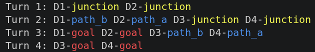
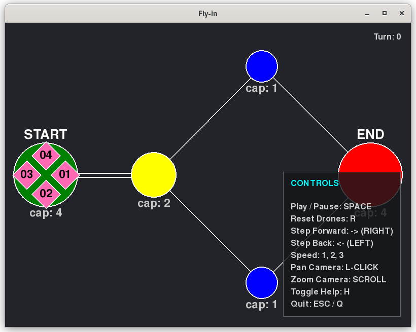

*This project has been created as part of the 42 curriculum by lbalderr.*

# Fly-In: Drone Network Simulation & Visualizer

## Description

Fly-In is a Python-based simulation and visualization engine designed to efficiently route a fleet of drones through a network topology given in a input file.

The primary goal of the project is to manage network traffic by guiding drones from a starting hub to an end hub in the fewest possible turns, navigating around restricted zones, traffic bottlenecks and multi-lane highways. By calculating optimal load-balancing paths and generating a step-by-step turn history, the program feeds this data into a custom 2D Pygame visualizer that brings the simulated network traffic to life through animations and interactive controls.

## Instructions

### Prerequisites

The project relies on Python 3 and modern libraries for data validation and rendering. Ensure you have the following installed:

- Python 3.10+
- Pygame (`pygame-ce` recommended)
- Pydantic v2

### Installation

Clone the repository and install the dependencies:

```bash
git clone https://github.com/lucasbpaiva/fly-in.git fly-in
cd fly-in
python -m venv venv
source venv/bin/activate
pip install -r requirements.txt
```

### Execution

Run the main entry point, passing your target network map as an argument (Optionally, use the flag -v to enable he graphical interface):

```bash
python fly_in.py -v map_file.txt
```

You can also use make to install dependencies and run the program:

```bash
make run MAP=map_file.txt ARGS=-v
```

### Visualizer Controls

Once the Pygame window launches, you can interact with the simulation using the following keybinds:

| Input | Action |
| --- | --- |
| `SPACE` | Play / Pause continuous playback |
| `→` (Right arrow) | Step forward (single turn) |
| `←` (Left arrow) | Step backward (single turn) |
| `R` | Reset animation to the beginning |
| Left click + drag | Pan the camera |
| Mouse scroll | Zoom in / out |
| `ESC` / `Q` | Quit |

## Algorithm Choices and Implementation Strategy

The core of the simulation relies on separating the data validation, the routing logic and the visual rendering into decoupled components, with a robust multi-agent pathfinding engine at its center:

1. **Strict Data Parsing (Pydantic v2):** The MapParser reads the raw .txt files and uses strictly typed Pydantic models to validate the graph topology. This ensures that invalid configurations (e.g., negative number of drones, disconnected graphs with no way to reach the end zone, or missing coordinates) are caught before the simulation begins.

1. **Graph Representation:** The network is mapped as a directed graph using Zone (nodes) and Connection (edges) objects. Opposite-moving traffic on bidirectional edges is grouped dynamically to share maximum capacity limits.

1. **Cooperative Pathfinding:** To efficiently manage traffic and prevent deadlocks, the simulation routes the fleet using Cooperative A*, a specialized multi-agent pathfinding (MAPF) algorithm. Instead of routing all drones simultaneously, the algorithm plans their paths sequentially across a time-space graph.

1. **Time-Space Reservation Table:** As each drone's optimal path is calculated, the algorithm logs its location at every discrete time step (turn) into a global reservation table. For subsequent drones, the A* algorithm cross-references this table. If a zone's max_drones or a connection's max_link_capacity is fully reserved at time t, that route is treated as temporarily impassable for that specific turn.

1. **Dynamic Load-Balancing:** Because capacities act as temporal obstacles, later drones are naturally forced to evaluate trade-offs. The A* heuristic calculates whether it is more efficient to issue a "wait" action (hovering in the current zone until capacity frees up) or to take a longer detour through low-capacity shortcuts. This mimics real-world traffic routing without causing infinite queues.

1. **Discrete Turn History:** The simulation runs headlessly first, outputting a complete, collision-free state history mapping every drone's ID to its exact location per turn. The visualizer then consumes this history to render the playback smoothly without recalculating logic on the fly.

## Visual Representation Features

The Pygame visualizer transforms raw simulation data into a visually engaging and interactive map:

- **Dynamic nodes:** Zones are rendered as circles sized proportionally to their capacity.
- **Blocked Zones:** Blocked zones, that must not be used, are immediately identifiable by a white "X" inscribed across their circular area. They also have a red highlight ring.
- **Restricted Zones:** Restricted zones, which take 2 turns to enter instead of 1, have a yellow highlight ring around them.
- **Priority Zones:** Priority zones, that take 1 turn to be reached like normal zones but must be prioritized by the algorithm, have a green highlight ring around them.
- **Multi-lane highways:** Connections with a capacity greater than 1 are visually split into distinct parallel lanes.
- **Zone capacity:** The capacity of each zone is indicated by a text below the circle, e.g. "cap: 3".
- **Smooth waypoint interpolation:** Drones are rendered as 45° tilted squares (diamonds) with 2-digit ID labels. To prevent visual overlapping, they do not just snap between nodes, they follow multi-segment waypoint paths to transition smoothly from circular zone slots to specific parallel lanes.
- **Responsive camera & UI:** The engine supports camera panning and scroll-wheel zooming that targets the mouse cursor. A semi-transparent dynamic legend is placed in the bottom-right corner of the UI to remind users of the playback controls.

## Example Input and Expected Output

### Example input map (`02_simple_fork.txt`)

```text
# Easy Level 2: Simple fork with two paths
nb_drones: 4

start_hub: start 0 0 [color=green]
hub: junction 1 0 [color=yellow max_drones=2]
hub: path_a 2 1 [color=blue]
hub: path_b 2 -1 [color=blue]
end_hub: goal 3 0 [color=red]

connection: start-junction [max_link_capacity=2]
connection: junction-path_a
connection: junction-path_b
connection: path_a-goal
connection: path_b-goal
```

### Expected output

Upon execution, a list of the moves made by the drones should be printed in the terminal, one turn per line:



If the visualization flag is active (-v or --visualize) an interactive pygame window should open showing the graph with the drones represented as numbered hot-pink diamonds gathered in a circle at the start zone:



## Resources

### References

- [Pygame Community Edition documentation](https://pyga.me/docs/) – for 2D rendering, event loops and keyboard/mouse interactions.
- [Pydantic v2 documentation](https://docs.pydantic.dev/latest/) – for structuring strict data validation pipelines.
- [Cooperative Pathfinding](https://davidstarsilver.wordpress.com/wp-content/uploads/2025/05/aiide-05.pdf) by David Silver - Paper that introduced the algorithm used in the simulation, cooperative A*.

### AI usage

AI tools (LLMs) were used collaboratively as a thought partner throughout the development of this project. Tasks the AI tools assisted with include:

- Validating and refactoring the algorithms to improve efficiency.
- Researching the appropriate tools and functions to give life to the graph topology and drone animations.
- Generating extra maps to test both the simulation and invalid entries for the parser.
